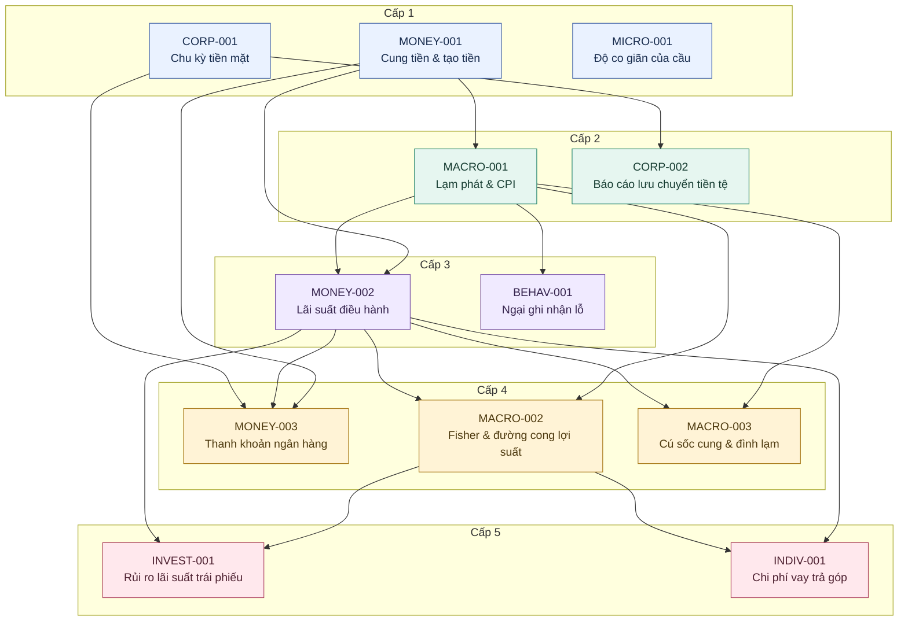

# Nhật ký Học tập Kinh tế (Economics Learning Log)

## Thứ tự đọc theo điều kiện tiên quyết

Bản đồ này được xếp theo `prerequisites` trong YAML của các bài đã có trong nhật ký. Các quan hệ tiên quyết hiện được giữ theo metadata; mức độ cần thiết của từng quan hệ chưa được rà soát riêng.

- **Cấp đọc thể hiện vị trí trong chuỗi tiên quyết; độ khó được ghi riêng bằng `difficulty`.** Bài không khai báo bài tiên quyết trong kho thuộc cấp 1; các bài còn lại có cấp bằng 1 cộng cấp cao nhất của các bài tiên quyết.
- Trước khi đọc một bài, hãy đọc các bài tiên quyết trực tiếp và những bài nền mà chúng phụ thuộc. Không cần hoàn thành toàn bộ các cấp thấp hơn; các bài cùng cấp có thể đọc theo thứ tự linh hoạt.
- Dấu “—” nghĩa là không khai báo bài tiên quyết trong kho, không có nghĩa bài học không cần kiến thức cơ bản.

### Sơ đồ các cấp và quan hệ tiên quyết

Mũi tên đi từ **bài tiên quyết → bài phụ thuộc**, theo đúng các quan hệ trực tiếp trong YAML. Một mũi tên có thể đi qua nhiều cấp; bài không có mũi tên nối vẫn thuộc cấp được ghi trong khung.

### Cấp 1

| ID | Bài học | Tiên quyết trực tiếp | Đường dẫn |
| :--- | :--- | :--- | :--- |
| MONEY-001 | Cung tiền M1, M2 và Cơ chế Tạo tiền của Ngân hàng Thương mại | — | [Bài học](topics/monetary-and-banking/money-supply-and-bank-money-creation.md) |
| CORP-001 | Chu kỳ chuyển đổi tiền mặt & Rủi ro Thanh khoản | — | [Bài học](topics/corporate-and-markets/cash-conversion-cycle.md) |
| MICRO-001 | Độ co giãn của cầu theo giá: Vì sao giảm giá chưa chắc tăng doanh thu? | — | [Bài học](topics/microeconomics/price-elasticity-of-demand-and-revenue.md) |

### Cấp 2

| ID | Bài học | Tiên quyết trực tiếp | Đường dẫn |
| :--- | :--- | :--- | :--- |
| MACRO-001 | Lạm phát: Bản chất, Phương pháp Đo lường CPI và Các Kênh Truyền dẫn Vĩ mô | MONEY-001 | [Bài học](topics/macroeconomics/inflation-cpi-and-macro-transmission.md) |
| CORP-002 | Báo cáo lưu chuyển tiền tệ: Vì sao có lợi nhuận vẫn thiếu tiền? | CORP-001 | [Bài học](topics/corporate-and-markets/cash-flow-statement-and-operating-cash-flow.md) |

### Cấp 3

| ID | Bài học | Tiên quyết trực tiếp | Đường dẫn |
| :--- | :--- | :--- | :--- |
| MONEY-002 | Lãi suất Điều hành và Các Kênh Truyền dẫn Chính sách Tiền tệ | MONEY-001, MACRO-001 | [Bài học](topics/monetary-and-banking/policy-rates-and-monetary-transmission.md) |
| BEHAV-001 | Ngại ghi nhận lỗ và hiệu ứng bán lãi sớm, giữ lỗ lâu | MACRO-001 | [Bài học](topics/behavioral-finance/loss-aversion-and-disposition-effect.md) |

### Cấp 4

| ID | Bài học | Tiên quyết trực tiếp | Đường dẫn |
| :--- | :--- | :--- | :--- |
| MONEY-003 | Thanh khoản ngân hàng: Vì sao có tài sản vẫn thiếu tiền chi trả? | MONEY-001, MONEY-002, CORP-001 | [Bài học](topics/monetary-and-banking/bank-liquidity-and-funding-risk.md) |
| MACRO-002 | Hiệu ứng Fisher và đường cong lợi suất: vì sao lãi suất dài hạn có thể thấp hơn ngắn hạn? | MACRO-001, MONEY-002 | [Bài học](topics/macroeconomics/fisher-effect-and-yield-curve.md) |
| MACRO-003 | Cú sốc cung, lạm phát chi phí đẩy và đình lạm: vì sao giá tăng khi kinh tế yếu? | MACRO-001, MONEY-002 | [Bài học](topics/macroeconomics/supply-shocks-cost-push-inflation-and-stagflation.md) |

### Cấp 5

| ID | Bài học | Tiên quyết trực tiếp | Đường dẫn |
| :--- | :--- | :--- | :--- |
| INVEST-001 | Rủi ro lãi suất của trái phiếu: Vì sao giá giảm khi lợi suất tăng? | MACRO-002, MONEY-002 | [Bài học](topics/investing/bond-prices-duration-and-interest-rate-risk.md) |
| INDIV-001 | Chi phí vay trả góp: vì sao cùng “12%/năm” có thể khác xa nhau? | MONEY-002, MACRO-002 | [Bài học](topics/personal-finance/installment-loans-flat-rates-and-effective-cost.md) |

## Nhật ký theo ngày

Ngày trong bảng là ngày học ban đầu; nội dung tóm tắt được đồng bộ sau đợt kiểm chứng 22/09/2026. Việc sửa kiến thức không tạo thêm một bài học đã hoàn thành.

| Ngày | ID | Category (Folder B) | Tên bài học (Topic Name) | Đường dẫn (File Path) | Ý chính cốt lõi (Core Takeaway) |
| :--- | :--- | :--- | :--- | :--- | :--- |
| 2026-08-04 | CORP-001 | corporate-and-markets | Chu kỳ chuyển đổi tiền mặt & Rủi ro Thanh khoản | [Bài học](topics/corporate-and-markets/cash-conversion-cycle.md) | CCC = DIO + DSO − DPO đo thời gian; tồn kho + phải thu − phải trả đo vốn hoạt động. Không dùng COGS/ngày × CCC như nhu cầu vay chính xác; phải lập lịch tiền mặt. |
| 2026-08-12 | MONEY-001 | monetary-and-banking | Cung tiền M1, M2 và Cơ chế Tạo tiền của Ngân hàng Thương mại | [Bài học](topics/monetary-and-banking/money-supply-and-bank-money-creation.md) | Khoản vay mới có thể tạo tiền gửi; vốn, rủi ro và nguồn vốn giới hạn ngân hàng. Tách tiền gửi, số dư dự trữ và tiền mặt; số nhân tiền là tỷ số hoặc mô hình có giả định, không phải quy trình tạo tiền thực tế. |
| 2026-08-13 | MACRO-001 | macroeconomics | Lạm phát: Bản chất, Phương pháp Đo lường CPI và Các Kênh Truyền dẫn Vĩ mô | [Bài học](topics/macroeconomics/inflation-cpi-and-macro-transmission.md) | CPI là chỉ số giá tiêu dùng; P trong MV = PY với GDP thực là giảm phát GDP. Đồng nhất thức không tự chứng minh nhân quả. Lợi suất thực sau kỳ = (1+i)/(1+π) − 1. |
| 2026-08-16 | MONEY-002 | monetary-and-banking | Lãi suất Điều hành và Các Kênh Truyền dẫn Chính sách Tiền tệ | [Bài học](topics/monetary-and-banking/policy-rates-and-monetary-transmission.md) | Chính sách truyền qua lãi suất, tín dụng, giá tài sản, tỷ giá và kỳ vọng với điều kiện/độ trễ thay đổi. Repo thường là tài trợ có bảo đảm; không đồng nhất Fed, ECB và NHNN thành hành lang đối xứng. |
| 2026-09-23 | CORP-002 | corporate-and-markets | Báo cáo lưu chuyển tiền tệ: Vì sao có lợi nhuận vẫn thiếu tiền? | [Bài học](topics/corporate-and-markets/cash-flow-statement-and-operating-cash-flow.md) | Lợi nhuận dồn tích khác OCF vì khoản phi tiền và biến động vốn lưu động hoạt động; ba nhóm hoạt động, đầu tư, tài trợ giải thích biến động tiền cuối kỳ. Ví dụ giả định kiểm tra OCF 35 triệu theo cả hai phương pháp. |
| 2026-09-24 | MACRO-002 | macroeconomics | Hiệu ứng Fisher và đường cong lợi suất: vì sao lãi suất dài hạn có thể thấp hơn ngắn hạn? | [Bài học](topics/macroeconomics/fisher-effect-and-yield-curve.md) | Lợi suất thực sau kỳ dùng lạm phát thực tế; Fisher trước kỳ dựa trên kỳ vọng và giả định. Lợi suất dài hạn phản ánh kỳ vọng lãi suất ngắn hạn và phần bù kỳ hạn; đảo ngược là tín hiệu có điều kiện, không bảo đảm suy thoái. |
| 2026-09-25 | BEHAV-001 | behavioral-finance | Ngại ghi nhận lỗ và hiệu ứng bán lãi sớm, giữ lỗ lâu | [Bài học](topics/behavioral-finance/loss-aversion-and-disposition-effect.md) | Giá mua có thể thành điểm tham chiếu tâm lý khiến nhà đầu tư dễ chốt lãi hơn chốt lỗ. Lý thuyết triển vọng chỉ gợi ý một động cơ; quyết định thực tế cần xét triển vọng từ giá hiện tại, rủi ro, nhu cầu tiền, phí và thuế. |
| 2026-09-27 | MONEY-003 | monetary-and-banking | Thanh khoản ngân hàng: Vì sao có tài sản vẫn thiếu tiền chi trả? | [Bài học](topics/monetary-and-banking/bank-liquidity-and-funding-risk.md) | Tiền gửi là nợ của ngân hàng, còn dự trữ tại NHTW là tài sản thanh toán; chuyển tiền giữa ngân hàng dịch chuyển dự trữ, không tự làm tổng dự trữ biến mất. Vốn dương không bảo đảm có tiền đúng hạn; bán gấp có thể gây lỗ vốn khi giá thực thu thấp hơn giá ghi sổ. |
| 2026-09-29 | MICRO-001 | microeconomics | Độ co giãn của cầu theo giá: Vì sao giảm giá chưa chắc tăng doanh thu? | [Bài học](topics/microeconomics/price-elasticity-of-demand-and-revenue.md) | Độ co giãn trung điểm so sánh mức đổi tương đối của lượng cầu và giá trên cùng đường cầu; doanh thu có thể tăng khi lượng tăng đủ mạnh, nhưng chi phí có thể làm lợi nhuận giảm. Quan sát giá và lượng bán qua hai thời điểm chưa xác định được riêng tác động nhân quả của giá. |

## Cập nhật ngày 2026-10-03

| Ngày | ID | Category (Folder B) | Tên bài học (Topic Name) | Đường dẫn (File Path) | Ý chính cốt lõi (Core Takeaway) |
| :--- | :--- | :--- | :--- | :--- | :--- |
| 2026-10-03 | INVEST-001 | investing | Rủi ro lãi suất của trái phiếu: Vì sao giá giảm khi lợi suất tăng? | [Bài học](topics/investing/bond-prices-duration-and-interest-rate-risk.md) | Với dòng tiền cố định được trả đầy đủ, YTM tăng làm giá trị hiện tại giảm; coupon khác YTM. Modified duration xấp xỉ độ nhạy giá khi YTM đổi nhỏ và dòng tiền không đổi; giữ đến đáo hạn không xóa chi phí cơ hội, vỡ nợ, lạm phát hoặc rủi ro tái đầu tư. |

## Cập nhật ngày 2026-10-11

| Ngày | ID | Category (Folder B) | Tên bài học (Topic Name) | Đường dẫn (File Path) | Ý chính cốt lõi (Core Takeaway) |
| :--- | :--- | :--- | :--- | :--- | :--- |
| 2026-10-11 | INDIV-001 | personal-finance | Chi phí vay trả góp: vì sao cùng “12%/năm” có thể khác xa nhau? | [Bài học](topics/personal-finance/installment-loans-flat-rates-and-effective-cost.md) | Tính lãi trên gốc ban đầu khác tính trên dư nợ giảm dần; khoản trả đều không đồng nghĩa trả gốc đều. IRR đối chiếu tiền nhận ròng với lịch trả; suất chi phí hiệu dụng năm = (1+i)^12 − 1 với i theo tháng. So sánh chi phí vay khác đánh giá khả năng trả đúng hạn. |

## Cập nhật ngày 2026-10-13

| Ngày | ID | Category (Folder B) | Tên bài học (Topic Name) | Đường dẫn (File Path) | Ý chính cốt lõi (Core Takeaway) |
| :--- | :--- | :--- | :--- | :--- | :--- |
| 2026-10-13 | MACRO-003 | macroeconomics | Cú sốc cung, lạm phát chi phí đẩy và đình lạm: vì sao giá tăng khi kinh tế yếu? | [Bài học](topics/macroeconomics/supply-shocks-cost-push-inflation-and-stagflation.md) | Chi phí tăng được phân bổ giữa giá, số dư đảm phí và lượng sản xuất; tác động trực tiếp, gián tiếp và vòng hai khác nhau. SRAS dịch trái với AD giữ nguyên chỉ là kết quả mô hình có điều kiện. Mức giá 100 → 102 → 102 không tạo lạm phát cao liên tục; đình lạm và phản ứng lãi suất phụ thuộc bối cảnh. |
