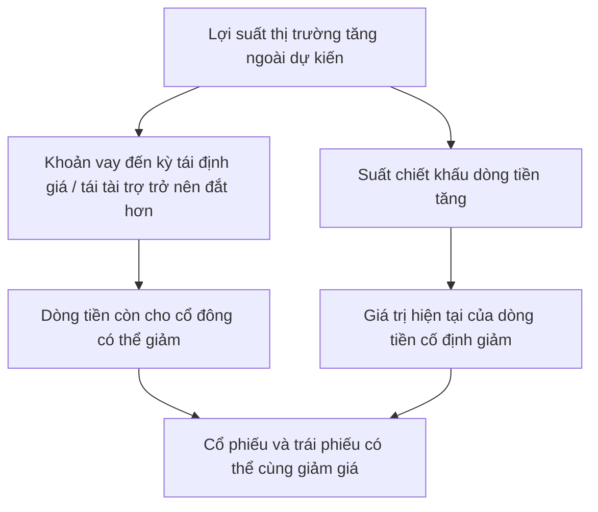

## 1. Chủ đề hôm nay

**Đa dạng hóa danh mục (portfolio diversification) và tương quan lợi suất (return correlation).**

Sau bài củng cố về kỳ vọng lạm phát, hôm nay ta mở rộng sang nền tảng đầu tư: đánh giá rủi ro của nhiều khoản nắm giữ khi đặt chúng cạnh nhau. Bài nối với [MONEY-002](../monetary-and-banking/policy-rates-and-monetary-transmission.md) để hiểu vì sao một thay đổi lãi suất có thể tác động đồng thời đến nhiều tài sản. Các phép tính thống kê được giải thích ngay trong bài.

## 2. Vấn đề cốt lõi

Bạn mua mười mã cổ phiếu, chia tiền vào ba quỹ và thấy mình đã có nhiều khoản đầu tư. Nhưng nếu tất cả đều phụ thuộc mạnh vào cùng một ngành hoặc nguồn vốn vay, một cú sốc vẫn có thể kéo chúng xuống cùng lúc.

Câu hỏi cần trả lời là: **mỗi khoản mới làm thay đổi mức phụ thuộc của toàn danh mục vào những rủi ro nào?** Đếm tên sản phẩm chưa trả lời được câu hỏi đó.

**[Definition]** Đa dạng hóa là phân bổ khoản đầu tư để giảm sự phụ thuộc vào một tài sản hoặc nguồn rủi ro. Nó không cam kết tránh lỗ khi thị trường giảm; SEC cũng nêu rõ giới hạn này trong [Diversify Your Investments](https://www.investor.gov/introduction-investing/investing-basics/save-and-invest/diversify-your-investments).

## 3. Giải thích cơ chế

### 3.1. Từ một tài sản sang cả danh mục

**[Definition]** Lợi suất nắm giữ một kỳ (*holding-period return*) đo phần tăng hoặc giảm giá trị so với vốn đầu kỳ. Với một khoản đầu tư không có giao dịch thêm:

$$
R_i=\frac{V_{i,1}+C_i-V_{i,0}}{V_{i,0}}
$$

Trong đó, $V_{i,0}>0$ là giá trị thị trường đầu kỳ, $V_{i,1}$ là giá trị cuối kỳ và $C_i$ là tiền phân phối nhận trong kỳ được giữ dưới dạng tiền không sinh lãi trong phép tính này. Ví dụ giả định: bỏ 50 triệu, cuối kỳ tài sản còn 53 triệu và nhận 2 triệu tiền phân phối thì lợi suất là $(53+2-50)/50=10\%$.

Với hai tài sản A và B, trọng số $w_A$, $w_B$ là tỷ phần **giá trị đầu kỳ**, có tổng bằng 1. Nếu không vay, không bán khống, không nạp/rút tiền và không giao dịch giữa kỳ, đồng thời bỏ qua phí, thuế:

$$
R_p=w_AR_A+w_BR_B
$$

**[Accounting Identity — trong phạm vi danh mục vừa xác định]** Công thức này theo từ việc cộng giá trị và khoản phân phối của hai phần tài sản. Trọng số cuối kỳ có thể khác đầu kỳ; không lấy trọng số cuối kỳ nhân ngược với lợi suất cả kỳ.

Khi kết quả còn chưa biết, ký hiệu $E(R)$ là lợi suất kỳ vọng theo các xác suất đang giả định. Tính tuyến tính của kỳ vọng cho:

$$
E(R_p)=w_AE(R_A)+w_BE(R_B)
$$

Chia tiền không tự tạo thêm lợi nhuận kỳ vọng vượt trung bình có trọng số của các khoản nắm giữ. Lợi ích đa dạng hóa cần tìm ở **cách kết quả bất định kết hợp với nhau**.

### 3.2. Tương quan đo điều gì?

**[Definition]** Phương sai (*variance*) là kỳ vọng của bình phương độ lệch lợi suất so với kỳ vọng của chính nó. Độ lệch chuẩn (*standard deviation*, $\sigma$) là căn bậc hai của phương sai, nên trở về cùng đơn vị với lợi suất.

**[Definition]** Hiệp phương sai (*covariance*) đo mức hai lợi suất cùng lệch khỏi kỳ vọng tương ứng. Khi cả hai độ lệch chuẩn dương, hệ số tương quan (*correlation coefficient*) chuẩn hóa nó:

$$
\rho_{AB}=\frac{\operatorname{Cov}(R_A,R_B)}{\sigma_A\sigma_B},\qquad -1\leq\rho_{AB}\leq1
$$

- $\rho=1$: hai lợi suất có quan hệ tuyến tính dương hoàn hảo quanh các kỳ vọng của chúng.
- $\rho=0$: không có tương quan tuyến tính; vẫn có thể phụ thuộc theo cách khác hoặc cùng giảm trong một kịch bản.
- $\rho=-1$: quan hệ tuyến tính âm hoàn hảo, một trường hợp biên dùng để hiểu cơ chế bù trừ.

Tương quan không cho biết tài sản nào có lợi suất kỳ vọng cao hơn, không chứng minh quan hệ nhân quả và không đồng nghĩa hai tài sản luôn mang dấu lợi suất trái nhau khi tương quan âm. Đây là các định nghĩa thống kê; bảng kịch bản ở mục 4 sẽ cho phép tự kiểm tra một trường hợp cụ thể.

### 3.3. TEXTBOOK MODEL — Mô hình Giáo trình: rủi ro hai tài sản

**[Theoretical Model] Giả định:** xét cùng một kỳ nắm giữ, cùng đồng tiền đo lường; trọng số đầu kỳ cố định như mục 3.1; lợi suất có phương sai hữu hạn. Để tính rủi ro trước kỳ, ta giả định biết các kỳ vọng, phương sai và tương quan. Không cần giả định lợi suất có phân phối chuẩn cho công thức dưới đây.

Từ định nghĩa phương sai của tổng có trọng số:

$$
\begin{aligned}
\sigma_p^2
&=E\!\left[\big(w_A(R_A-E(R_A))+w_B(R_B-E(R_B))\big)^2\right]\\
&=w_A^2\sigma_A^2+w_B^2\sigma_B^2+2w_Aw_B\rho_{AB}\sigma_A\sigma_B.
\end{aligned}
$$

Ý nghĩa kinh tế của số hạng cuối: nếu hai khoản thường cùng lệch xuống dưới kỳ vọng, chúng ít bù trừ cho nhau. Khi giữ nguyên trọng số và độ biến động riêng, tương quan thấp hơn làm phương sai danh mục thấp hơn. CFA Institute xác định ba thành phần này — tỷ trọng, độ lệch chuẩn và tương quan — trong [Portfolio Risk and Return: Part I, phần Summary](https://www.cfainstitute.org/insights/professional-learning/refresher-readings/2026/portfolio-risk-return-part-1).

**Ví dụ tham số hoàn toàn giả định:** $w_A=w_B=0{,}5$, $\sigma_A=\sigma_B=20\%=0{,}20$. Khi đó:

$$
\sigma_p^2=0{,}02(1+\rho_{AB}).
$$

| Tương quan giả định | Độ lệch chuẩn danh mục | Điều phép tính cho thấy |
| :--- | :--- | :--- |
| $1$ | $20\%$ | Hai khoản có cùng độ biến động và đồng biến hoàn hảo, nên chia đôi không giảm biến động. |
| $0$ | $\sqrt{0{,}02}\approx14{,}14\%$ | Biến động thấp hơn từng khoản trong ví dụ này dù không cần tương quan âm. |
| $-1$ | $0\%$ | Với đúng trọng số và độ biến động bằng nhau này, các độ lệch triệt tiêu hoàn toàn trong mô hình. |

**Mô hình chứng minh điều gì?** Có thể giảm độ biến động bằng cách kết hợp tài sản, ngay cả khi mỗi tài sản vẫn biến động mạnh. Công thức phương sai là hệ quả toán học chính xác theo các điều kiện trên; dùng tham số nào cho tương lai là vấn đề khác.

**Giới hạn:** mức $14{,}14\%$ không phải mức lỗ tối đa hay một xác suất. Mức $0\%$ chỉ nói lợi suất bằng kỳ vọng trong mọi kịch bản có xác suất dương của trường hợp lý tưởng này; chưa nói kỳ vọng ấy dương hay sức mua được bảo toàn. Nếu hai tài sản có độ biến động khác nhau, tương quan thấp cũng không bảo đảm hỗn hợp ít biến động hơn **từng** tài sản.

### 3.4. Rủi ro nào có thể phân tán, rủi ro nào còn lại?

**[Definition]** Rủi ro riêng (*idiosyncratic/nonsystematic risk*) gắn với một doanh nghiệp hoặc khoản đầu tư. Rủi ro thị trường mang tính hệ thống (*systematic risk*) là phần rủi ro chung không tự biến mất khi tăng số mã trong cùng thị trường. Đây là phân biệt trong [CFA Institute, Portfolio Risk and Return: Part II, phần Summary](https://www.cfainstitute.org/insights/professional-learning/refresher-readings/2026/portfolio-risk-return-part-2). Không nhầm *systematic risk* với *systemic risk* — nguy cơ đổ vỡ hoặc gián đoạn lan trong hệ thống tài chính.

**[Theoretical Model — ví dụ tự xây dựng]** Giả sử lợi suất của mỗi cổ phiếu có dạng:

$$
R_i=\mu_i+F+\varepsilon_i.
$$

$\mu_i$ là kỳ vọng; $F$ là cú sốc chung có kỳ vọng 0; $\varepsilon_i$ là cú sốc riêng có kỳ vọng 0. Giả định mọi cổ phiếu chịu cùng mức tác động từ $F$, các cú sốc riêng không tương quan với nhau hoặc với $F$, và mỗi cú sốc riêng có phương sai $s^2$. Với $n$ cổ phiếu chia đều vốn:

$$
\operatorname{Var}(R_p)=\operatorname{Var}(F)+\frac{s^2}{n}.
$$

Mỗi cổ phiếu mới thu nhỏ phần tác động của một sự cố riêng vào toàn danh mục; các phần riêng không cộng hưởng theo giả định. Nhưng trung bình của $n$ lần cùng chịu $F$ vẫn là $F$. Vì vậy, phần chung còn nguyên. Công thức không hứa rủi ro riêng trong thực tế luôn giảm đúng theo $1/n$: mức tập trung và quan hệ giữa các cú sốc có thể khác giả định.

### 3.5. REAL-WORLD MECHANISM — Cơ chế Thực tế

Nhà đầu tư quyết định phân bổ vốn; doanh nghiệp tạo ra dòng tiền và chịu các cú sốc kinh doanh; người quản lý quỹ mua tài sản theo chiến lược hoặc chỉ số của quỹ. Mua thêm một chứng chỉ quỹ làm thay đổi tài sản bạn gián tiếp nắm giữ theo danh mục nền của quỹ, chứ không tạo ra một nguồn rủi ro độc lập chỉ vì quỹ có tên khác.

**[Definition]** Rủi ro tập trung (*concentration risk*) là nguy cơ tổn thất bị khuếch đại do phần lớn danh mục phụ thuộc vào một khoản, nhóm tài sản hoặc phân khúc. FINRA lưu ý phải nhìn xuyên qua các quỹ để kiểm tra tài sản trùng nhau và cả mức dễ bán khi cần tiền. [FINRA, Concentrate on Concentration Risk, 15/06/2022](https://www.finra.org/investors/insights/concentration-risk).

**Ví dụ giả định về tài sản nền:** bạn đặt 50% tiền vào quỹ X và 50% vào quỹ Y; X có 40% giá trị ở cổ phiếu K, Y có 60% ở K. Cùng một thời điểm định giá, với quỹ không dùng đòn bẩy hay phái sinh, tỷ trọng gián tiếp của K là:

$$
w_K=0{,}50\times0{,}40+0{,}50\times0{,}60=50\%.
$$

Hai tên quỹ vẫn để một nửa vốn phụ thuộc vào cùng công ty. Ví dụ này chỉ cộng phần sở hữu gián tiếp, không gán xác suất thua lỗ cho K và không phải mô tả một quỹ thực tế nào.

**Rào cản và điều kiện biên:** các tham số tương lai không được biết chắc; tương quan tính từ dữ liệu quá khứ có thể không phù hợp cho kỳ tới. Khi ước lượng, phải thống nhất đồng tiền, tần suất và khoảng dữ liệu. Shiller đặt rõ giả định tiếp tục dùng đặc điểm quá khứ cho tương lai khi trình bày mô hình trong [Yale, Lecture 4, chương 4 và 6, 2011](https://oyc.yale.edu/economics/econ-252-11/lecture-4). Phí, thuế, giới hạn giao dịch và nhu cầu rút tiền cũng nằm ngoài mô hình đơn giản.

## 4. Ví dụ trực quan: tương quan bằng 0 vẫn có lúc cùng lỗ

**[Theoretical Model — toàn bộ số liệu và xác suất đều giả định]** Bạn có 100 triệu đồng, đầu kỳ đặt 50 triệu vào A và 50 triệu vào B. Giữ một năm, không vay hoặc giao dịch thêm, bỏ qua phí và thuế. Lợi suất dưới đây đã gồm mọi khoản phân phối:

| Kịch bản một năm | Xác suất giả định | Lợi suất A | Lợi suất B | Lợi suất danh mục | Giá trị cuối kỳ |
| :--- | :--- | :--- | :--- | :--- | :--- |
| 1 | 25% | +30% | +30% | +30% | 130 triệu |
| 2 | 25% | +30% | −10% | +10% | 110 triệu |
| 3 | 25% | −10% | +30% | +10% | 110 triệu |
| 4 | 25% | −10% | −10% | −10% | 90 triệu |

Mỗi tài sản có lợi suất kỳ vọng $10\%$; độ lệch khỏi kỳ vọng là $+20$ hoặc $-20$ **điểm phần trăm**. Phương sai mỗi tài sản là $0{,}04$ và độ lệch chuẩn $20\%$ khi tính lợi suất dưới dạng số thập phân.

Tích các độ lệch của A và B qua bốn kịch bản là $+0{,}04;-0{,}04;-0{,}04;+0{,}04$. Bình quân theo xác suất bằng 0, nên hiệp phương sai và tương quan bằng 0. Trong bảng tự xây dựng này A và B còn độc lập, nhưng đó là đặc điểm riêng của bảng, không phải hệ quả chung của tương quan bằng 0.

Danh mục cũng có kỳ vọng $10\%$, nhưng các độ lệch chỉ là $+20;0;0;-20$ điểm phần trăm:

$$
\sigma_p=\sqrt{0{,}25(0{,}20)^2+0{,}25(0)^2+0{,}25(0)^2+0{,}25(-0{,}20)^2}
=\sqrt{0{,}02}\approx14{,}14\%.
$$

Như vậy độ biến động giảm, còn lợi suất kỳ vọng giữ nguyên trong phép so sánh này. Kịch bản 4 vẫn làm bạn mất 10 triệu. Xác suất lỗ 25% và mức lỗ 10% chỉ thuộc **bảng giả định bốn kịch bản**, không được suy từ độ lệch chuẩn để áp cho thị trường.

## 5. Tình huống thực tế: nhiều khoản cùng nhạy với lãi suất

**[Causal Mechanism — tình huống giả định, không phải bản tin hoặc dự báo]** Một người nắm cổ phiếu doanh nghiệp vay nhiều và trái phiếu lãi suất cố định dài hạn. Giả sử lợi suất thị trường tăng ngoài dự kiến, không kèm tin tốt đủ bù trừ về dòng tiền:

Với doanh nghiệp, tác động chi phí vay phụ thuộc hợp đồng thả nổi hay cố định, lịch đáo hạn và khả năng chuyển chi phí sang giá bán. Với trái phiếu, giữ nguyên các dòng tiền được trả đầy đủ thì lợi suất chiết khấu cao hơn làm giá hiện tại thấp hơn — cơ chế đã học trong [INVEST-001](bond-prices-duration-and-interest-rate-risk.md).

Vì vậy, khác tên loại tài sản chưa bảo đảm có phản ứng đối nghịch. Tuy nhiên, nếu lãi suất tăng cùng triển vọng doanh thu tốt hơn, cổ phiếu có thể được hỗ trợ bởi dòng tiền kỳ vọng cao hơn. Một kỳ cùng giảm không chứng minh tương quan luôn dương hoặc bằng 1; phải tách cú sốc đang xét khỏi các lực bù trừ.

**Một lớp khác là thời điểm cần tiền.** Giả sử bạn cần 20 triệu đúng cuối năm, còn danh mục rơi vào kịch bản 4 ở mục 4. Bổ sung giả định A và B không phân phối tiền trong năm, nên toàn bộ 90 triệu cuối kỳ vẫn nằm trong hai tài sản cần bán để đổi lấy tiền. Nếu không có nguồn tiền khác, bạn phải bán một phần tại mức giá đang giảm để có 20 triệu chi trả. Đa dạng hóa đã giảm biến động theo mô hình nhưng chưa tạo sẵn tiền chi trả. Nếu tài sản còn khó bán, giá trị định giá cũng chưa chắc chuyển thành tiền kịp hạn. Đây là phân biệt giữa rủi ro danh mục và thanh khoản, nối với [MONEY-003](../monetary-and-banking/bank-liquidity-and-funding-risk.md).

## 6. Những hiểu lầm phổ biến

| Hiểu lầm | Cách hiểu chính xác hơn |
| :--- | :--- |
| “Nhiều mã hoặc nhiều quỹ là đủ.” | Cần cộng tỷ trọng tài sản nền và nhận diện nguồn rủi ro chung; ví dụ hai quỹ vẫn có thể để 50% vốn ở một cổ phiếu. |
| “Phải có tương quan âm mới giảm rủi ro.” | Với hai khoản cùng độ biến động ở mục 3.3, tương quan 0 đã giảm độ lệch chuẩn so với 1. |
| “Thêm bất kỳ tài sản nào cũng làm danh mục an toàn hơn.” | Tài sản mới có thể rất biến động hoặc làm tăng tập trung; kết quả còn phụ thuộc tỷ trọng và hiệp phương sai với phần đang giữ. |
| “Độ lệch chuẩn thấp nghĩa là không thể mất vốn lớn.” | Độ lệch chuẩn đo phân tán quanh kỳ vọng, không trực tiếp giới hạn thua lỗ, đo nhu cầu tiền hay mô tả đầy đủ các kết quả cực đoan. |
| “Hai khoản vừa cùng giảm nên đa dạng hóa vô ích.” | Một kết quả xấu vẫn tương thích với lợi ích giảm biến động trước kỳ; bảng mục 4 minh họa chính xác điều đó. |

## 7. Kiến thức này có ích gì với tôi?

Khi đọc tin “cả cổ phiếu lẫn trái phiếu đều giảm”, bạn có thể tìm cú sốc chung tác động đến chi phí vốn, dòng tiền hoặc suất chiết khấu. Không cần suy ngay rằng mọi cơ chế phân tán rủi ro đã biến mất.

Khi xem một danh mục, hãy bắt đầu từ số tiền và tỷ trọng theo giá trị thị trường, rồi nhìn xuyên qua quỹ để cộng những khoản trùng. Tiếp theo, xét một tình huống cụ thể: nếu nguồn vốn vay đắt hơn, khách hàng cùng giảm mua, hoặc bạn cần tiền sớm, những khoản nào bị ảnh hưởng đồng thời? Đây là cách kiểm tra mức phụ thuộc, chưa phải cách chọn tỷ trọng tối ưu cho một cá nhân.

Đối với quản lý tiền, hãy phân biệt ba việc: giảm phụ thuộc vào một nguồn rủi ro; chấp nhận mức biến động phù hợp với mục tiêu; và có tiền dùng đúng hạn. Một danh mục phân tán hơn vẫn có thể không phù hợp cho khoản chi sắp đến hạn.

## 8. Nguồn tham khảo

Đối chiếu ngày **06/11/2026**. Bài dùng kiến thức nền và ví dụ tự xây dựng; không sử dụng số liệu lợi suất hoặc tương quan thị trường hiện hành. Với CFA, phần đã đọc là trang giới thiệu/tóm tắt công khai, không phải toàn bộ giáo trình trong Learning Ecosystem.

1. **CFA Institute (giáo trình 2026)** — [Portfolio Risk and Return: Part I](https://www.cfainstitute.org/insights/professional-learning/refresher-readings/2026/portfolio-risk-return-part-1), mục Learning Outcomes và Summary. Hỗ trợ vai trò của trọng số, độ lệch chuẩn, hiệp phương sai và tương quan.
2. **CFA Institute (giáo trình 2026)** — [Portfolio Risk and Return: Part II](https://www.cfainstitute.org/insights/professional-learning/refresher-readings/2026/portfolio-risk-return-part-2), mục Introduction và Summary. Hỗ trợ phân biệt systematic/nonsystematic risk; bài không sử dụng kết luận định giá của CAPM.
3. **Robert J. Shiller, Yale University (2011)** — [Lecture 4 — Portfolio Diversification and Supporting Financial Institutions](https://oyc.yale.edu/economics/econ-252-11/lecture-4), transcript chương 4 và 6. Hỗ trợ mô hình danh mục và việc tách giả định thống kê khỏi dữ liệu tương lai.
4. **FINRA (15/06/2022)** — [Concentrate on Concentration Risk](https://www.finra.org/investors/insights/concentration-risk). Hỗ trợ nhận diện tập trung, danh mục nền trùng nhau và giới hạn thanh khoản.
5. **U.S. Securities and Exchange Commission, Investor.gov (trang không ghi ngày công bố)** — [Diversify Your Investments](https://www.investor.gov/introduction-investing/investing-basics/save-and-invest/diversify-your-investments). Hỗ trợ giới hạn: đa dạng hóa không bảo đảm tránh lỗ khi thị trường giảm.

## 9. Liên kết kiến thức

- **Phân bổ tài sản (asset allocation):** chọn tỷ trọng giữa các nhóm tài sản theo mục tiêu, thời hạn và khả năng chịu rủi ro; chưa giải bài toán tỷ trọng tối ưu trong bài này.
- **Tái cân bằng danh mục (portfolio rebalancing):** điều chỉnh tỷ trọng khi giá hoặc mục tiêu thay đổi; cần học riêng về quy tắc, phí và thuế.
- **Mức nhạy với nhân tố và beta (factor exposure & beta):** đo danh mục phụ thuộc vào biến động chung đến đâu, thay vì chỉ đếm mã.
- **Rủi ro đuôi và kiểm tra sức chịu đựng (tail risk & stress testing):** xét những tình huống thua lỗ lớn mà một con số độ lệch chuẩn không mô tả đầy đủ.

## 10. Điều đáng nhớ nhất

1. Rủi ro danh mục phụ thuộc tỷ trọng, độ biến động từng khoản và cách lợi suất cùng biến động.
2. Phân tán rủi ro riêng không tự xóa rủi ro chung; nhiều quỹ vẫn có thể giữ cùng tài sản nền.
3. Giảm biến động trước kỳ vẫn cho phép một kỳ cùng lỗ, và không bảo đảm có tiền đúng lúc cần.

## 11. Góc Phản xạ & Active Recall (Dành cho bạn)

Hãy thử giải thích cho một người bạn bằng 2–3 câu: vì sao hai quỹ có tên khác nhau vẫn có thể để một nửa tiền của họ phụ thuộc vào cùng một công ty?

**Thang tự đánh giá (1–5):** Bạn tự thấy mức độ hiểu/nhớ cơ chế hôm nay ở mức nào (1 = Cần đọc lại sớm / 3 = Nắm vững / 5 = Rất tự tin)? Nếu bạn chọn 1–2, hệ thống sẽ ưu tiên quay lại củng cố sớm hơn.
